# Mannat Moon Construction — Architecture and Diagrams

This document describes the repository's current implementation, based on
`app.py`, `snapshot_routes.py`, `snapshot_service.py`, `owner_scope.py`,
`permission_policy.py`, the templates, browser modules, and Firestore Rules.
It is a source-level map, not a claim that every optional external integration
has been configured or exercised in every environment.

## 1. System at a glance

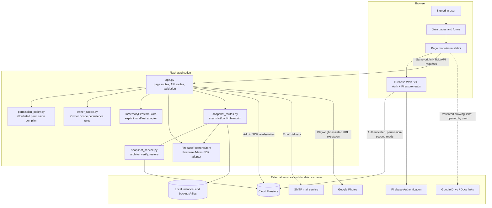

### Runtime and trust boundaries

| Area | Responsibility | Important boundary |
|---|---|---|
| Browser templates | Render page structure and server-provided CSRF/session metadata | Do not contain Firebase Admin credentials |
| Browser modules | Render and validate page interactions; read selected collections through Firebase Web SDK; send mutations to Flask | Firestore Rules deny direct browser writes |
| `app.py` | Flask setup, session/account logic, page/API routes, validation and application-level mutations | APIs independently authenticate, authorize and validate writes |
| `snapshot_routes.py` | Registers the Snapshots blueprint and authenticated public Firebase Web config endpoint | Snapshot management is Super Admin-only and CSRF-protected |
| `permission_policy.py` | Compiles built-in/custom roles into an allowlisted set of permission identifiers | Unknown permissions and inactive users do not gain authority |
| `owner_scope.py` | Validates and performs Owner Scope item/payment mutations and reads | Uses Firestore transactions and validates the legacy-source metadata |
| `snapshot_service.py` | Encodes Firestore values, writes/verifies snapshot archives and restores data | Local archives and restore credentials are filesystem resources |
| `FirebaseFirestoreStore` | Uses Firebase Admin SDK for persistence and trusted writes | Admin SDK bypasses Firestore Rules; Flask authorization remains required |
| `InMemoryFirestoreStore` | In-memory implementation used when explicitly selected or injected | Non-durable; it is not the production persistence layer |
| `firestore.rules` | Verifies active Flask-linked Firebase sessions and permission claims for browser reads | Default deny; every listed collection denies browser writes |
| `wsgi.py` | Imports the existing Flask app and serves it through Waitress | Refuses insecure production startup configuration |

The application is primarily function- and module-oriented. Domain records are
Firestore documents (ordinary Python/JavaScript dictionaries), not ORM model
instances. The class diagram below therefore distinguishes implemented
classes from route/module responsibilities.

In the current source, the Drawings and Materials page-shell routes render their
templates behind `require_login`. Their Firebase bootstrap endpoints and
mutation APIs also independently require an authenticated session and apply
their own authorization controls; the page-shell behavior is shown separately
from data access in the workflows below.

## 2. Source and page/module map

### Server-side source

| Source | Main responsibility |
|---|---|
| `app.py` | Flask application, Firebase configuration loading, storage adapters, account/session logic, permission checks, validations, feature pages and APIs |
| `permission_policy.py` | Permission identifiers, built-in role permission sets and custom-role permission compilation |
| `owner_scope.py` | Owner Scope schema validation, metadata checks, reads, transactional create/update/delete, and payment handling |
| `snapshot_routes.py` | Snapshot UI/API, Firebase Web config route, credentials intake, restore preview/confirmation, project switching |
| `snapshot_service.py` | Firestore traversal, archive serialization, verification, restore batching and failure reporting |
| `wsgi.py` | Production Waitress entry point and startup configuration checks |
| `scripts/` | Explicit Owner Scope initialization, migration, finalization and split utilities; not normal web-request handlers |

### Pages and browser modules

| Feature/page | Template | Main browser code | Data path |
|---|---|---|---|
| Dashboard | `templates/dashboard.html` | Inline module, shared navigation and page assets | Flask-rendered page; supporting APIs/read paths as implemented |
| Trade Builder | `templates/index.html` | `static/app.js`, `static/contract_payment_summary.mjs`, `static/trade_payment_history.mjs`, `static/payment_sort.mjs` | Firebase Web reads; Flask trade/contract/payment mutations |
| Daily Reports | `templates/daily_reports.html` | `static/daily_reports.js`, `static/daily_report_sharing.js` | Firestore reads; Flask Daily Records APIs for mutations and helper data |
| Daily Report viewer template | `templates/daily_reports_viewer.html` | `static/daily_report_sharing.js` | Currently not rendered by any Flask route; the active share link targets the authenticated Daily Reports page |
| Drawings | `templates/drawings.html` | `static/drawings.js` | Firestore reads; Flask category/drawing mutations |
| Materials | `templates/materials.html` | `static/materials.js`, `static/materials_logic.mjs` | Firestore reads; Flask master-data and transaction mutations |
| Labour Payments | `templates/index.html` financial view and `templates/labour_payments.html` | Shared `static/app.js`/payment logic and page-specific template behavior | Trade reads; Flask labour-payment mutations |
| Owner Scope | `templates/owner_scope.html` | `static/owner_scope.js`, related sort/PDF/confirmation modules | Flask JSON APIs and `owner_scope.py` reads/mutations |
| Building Cost Summary | `templates/building_cost_summary.html` | `static/building_cost_summary.js`, `static/building_cost_summary_logic.mjs` | Permission-scoped Firestore reads and client-side summary calculation |
| Ledger / Payment Reports | `templates/ledger_prints.html` | `static/ledger_prints.js`, `static/ledger_pdf.js`, payment sorting/history utilities | Firestore reads; PDF generation in the browser |
| Snapshots | `templates/snapshots.html` | `static/snapshots.js` | Authenticated Flask APIs; local archive files and Admin SDK |
| Profile | `templates/profile_settings.html` | `static/profile_settings.js`, `static/animal_avatars.js` | Flask profile/avatar APIs |
| User management | `templates/user_management.html`, `templates/user_details.html` | Inline modules and Flask forms/APIs | Flask account/role management |
| Authentication/recovery | Login, reset, password-change and recovery templates | Form submissions to Flask | Flask session, user store, token/email flows |
| Google Photos | `templates/google_photos.html` | Form/UI behavior in Flask-rendered flow | Flask + Playwright browser pool + remote image URL |
| Help | User/developer guide templates | Shared layout/navigation | Server-rendered documentation pages |

Common browser utilities include `static/firebase_auth.js` (Firebase bootstrap),
`static/dialogs.js` (dialogs/notifications), `static/date_format.js`,
`static/animal_avatars.js`, and the shared design/navigation/style sheets.
`static/office_connection.js` and `static/office_connection.css` remain unused
legacy assets; they are no longer injected into rendered pages.
`static/old_daily_reports.js` is an older
parallel Daily Reports implementation; the active `daily_reports.html` loads
`daily_reports.js`.

### Shared browser asset inventory

| Group | Assets |
|---|---|
| Firebase and page behavior | `app.js`, `firebase_auth.js`, `daily_reports.js`, `old_daily_reports.js` (legacy), `drawings.js`, `materials.js`, `building_cost_summary.js`, `ledger_prints.js`, `owner_scope.js`, `profile_settings.js`, `snapshots.js`, `daily_report_sharing.js` |
| Reusable logic | `building_cost_summary_logic.mjs`, `contract_payment_summary.mjs`, `materials_logic.mjs`, `owner_scope_constants.mjs`, `owner_scope_data.mjs` (read helper, not imported by the active `owner_scope.js`), `owner_scope_delete_confirmation.mjs`, `owner_scope_sort.mjs`, `payment_sort.mjs`, `settlement_logic.mjs`, `trade_payment_history.mjs` |
| Shared utilities | `animal_avatars.js`, `date_format.js`, `dialogs.js`, `ledger_pdf.js`, `owner_scope_pdf.js` |
| Styles | `style.css`, `design_system.css`, `mm_navigation.css`, `dialogs.css`, `site_motion.css`, `dashboard.css`, `daily_reports.css`, `drawings.css`, `materials.css`, `building_cost_summary.css`, `ledger_prints.css`, `owner_scope.css`, `profile_settings.css`, `snapshots.css` |

The templates also include `_navigation.html`, `dashboard.html`,
`index.html`, `daily_reports.html`, `daily_reports_viewer.html`,
`drawings.html`, `materials.html`, `labour_payments.html`,
`building_cost_summary.html`, `ledger_prints.html`, `owner_scope.html`,
`snapshots.html`, `profile_settings.html`, `login.html`,
`password_reset_request.html`, `forgot_password.html`, `reset_password.html`,
`change_password.html`, `super_admin_recovery.html`,
`user_management.html`, `user_details.html`, `google_photos.html`,
`user_guide.html`, and `developer_guide.html`.

`daily_reports_viewer.html` is presently an unreferenced template, not an
available webpage route. The active share link points to `/daily-reports`,
which requires the Daily Reports permission. Do not expose the orphan viewer
publicly without an explicit authorization and data-disclosure design.

## 3. Class and module diagram

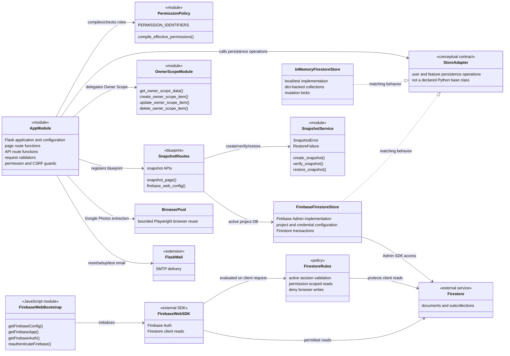

`StoreAdapter` is a diagram-level concept only: the repository does not declare
a Python abstract base class or formal protocol. The two store classes implement
the application operations independently. Likewise, domain entities are
document shapes rather than Python classes.

## 4. Firestore collection and relationship diagram

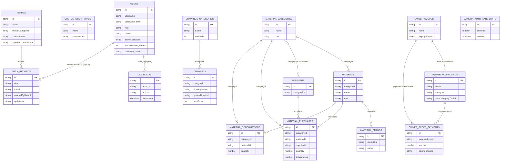

Relationships are logical references, not relational foreign-key constraints.
Trade contracts and labour payment transactions are stored within their parent
trade documents by the current store methods; Owner Scope items/payments are
Firestore subcollections. Field sets can have optional/legacy-compatible
members beyond those shown.

## 5. Authentication, authorization, and common request flows

### 5.1 Flask sign-in and session lifecycle

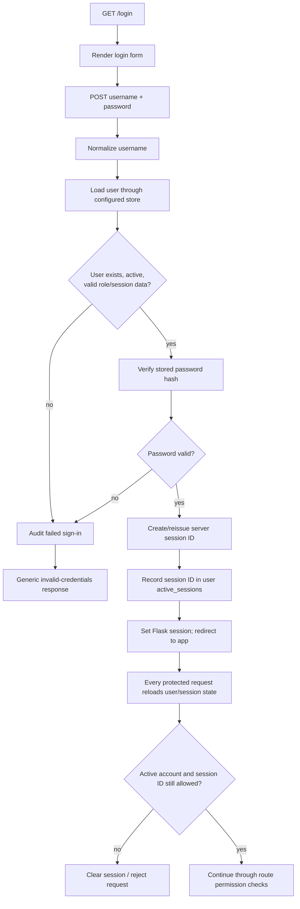

The Flask session is the application login. A browser Firebase token is issued
only as a bridge for Firestore reads; it does not replace the Flask session.

### 5.2 Firebase Web bootstrap and Firestore read authorization

```mermaid
sequenceDiagram
    actor User
    participant Page as Browser page module
    participant AuthJS as firebase_auth.js
    participant Flask as Flask routes
    participant Admin as Firebase Admin SDK
    participant Auth as Firebase Authentication
    participant Rules as Firestore Rules
    participant DB as Cloud Firestore

    User->>Page: Open authenticated page
    Page->>AuthJS: await firebaseAuthReady
    AuthJS->>Flask: GET /api/firebase-web-config
    Flask-->>AuthJS: Public Web config, no-store
    AuthJS->>AuthJS: Import Firebase Web SDK; initialize app/auth
    AuthJS->>Flask: GET /api/firebase-custom-token
    Flask-->>AuthJS: Session-bound CSRF token
    AuthJS->>Flask: POST /api/firebase-custom-token + CSRF
    Flask->>Flask: Verify Flask session, status, permissions, claims
    Flask->>Admin: Create custom token for server-selected user
    Admin-->>Flask: Signed custom token
    Flask-->>AuthJS: Custom token
    AuthJS->>Auth: Sign in with custom token
    Auth-->>Page: Authenticated Firebase user
    Page->>DB: Read allowed collection(s)
    DB->>Rules: Evaluate token/session/permission claim
    Rules-->>DB: Allow scoped read or deny
    DB-->>Page: Read result or permission/network error
    Page->>Flask: Mutation API with session + feature CSRF
    Flask->>Flask: Re-check user, permission, CSRF, payload
    Flask->>Admin: Perform trusted write
    Admin->>DB: Create/update/delete
```

No Admin credential or private key belongs in the browser. Direct Web SDK
mutations are denied by `firestore.rules`; trusted mutations go through
permission-checked Flask routes.

### 5.3 Shared mutation API guard

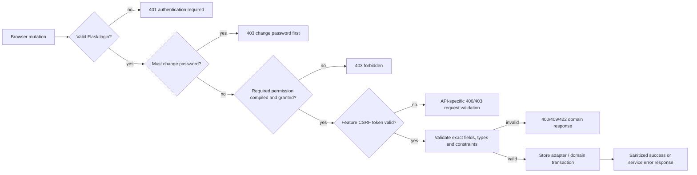

Exact status codes and tokens vary by API family; consult the route implementation
before building a client against an individual endpoint.

## 6. Feature workflow diagrams

### 6.1 Dashboard and navigation

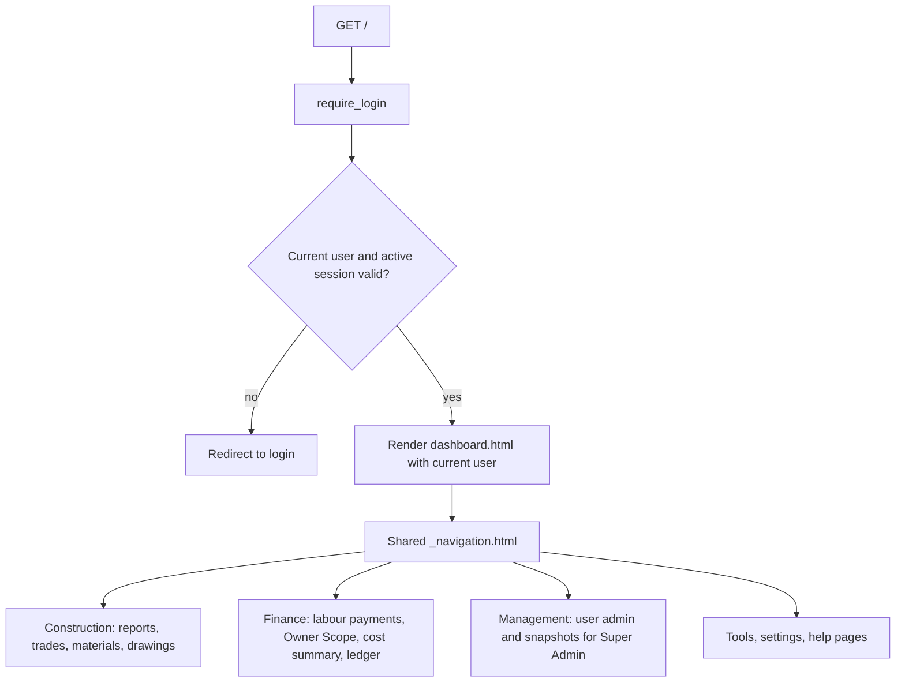

### 6.2 Daily Reports

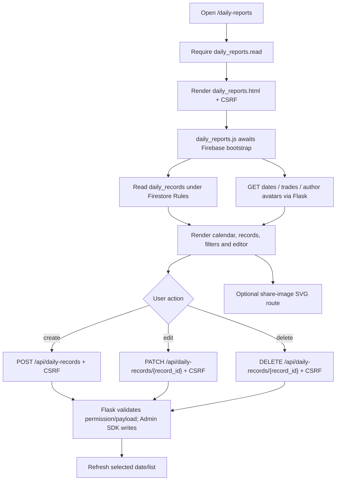

### 6.3 Drawings

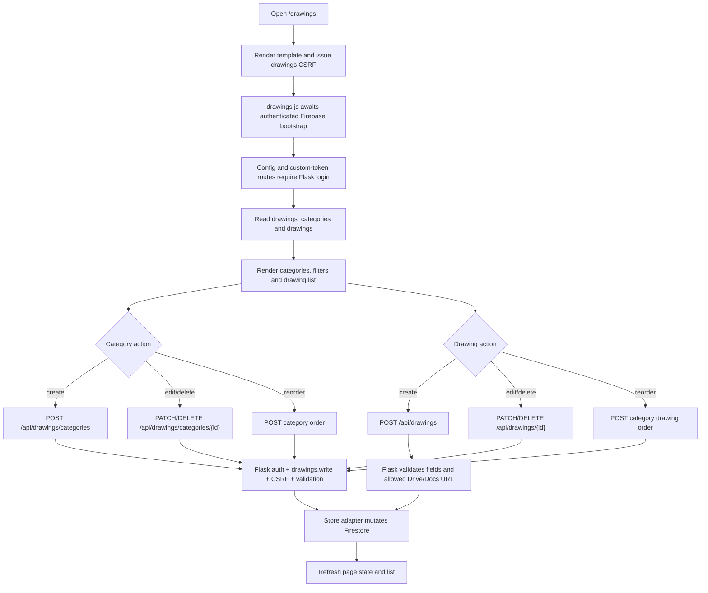

### 6.4 Materials

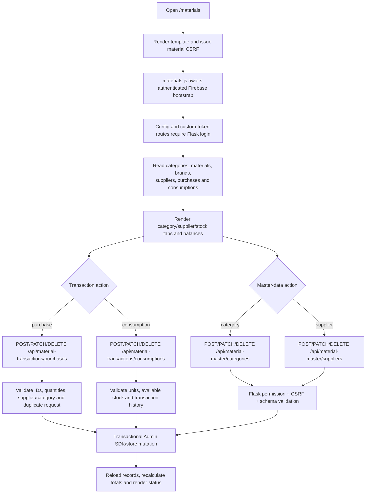

Brand records/associations are read from the Firestore material data model and
are coordinated through the Materials workflows as implemented; the listed
master-data APIs in `app.py` expose category and supplier operations. Do not
infer an independent public brand CRUD API from the diagram.

### 6.5 Trades, contract values and labour payments

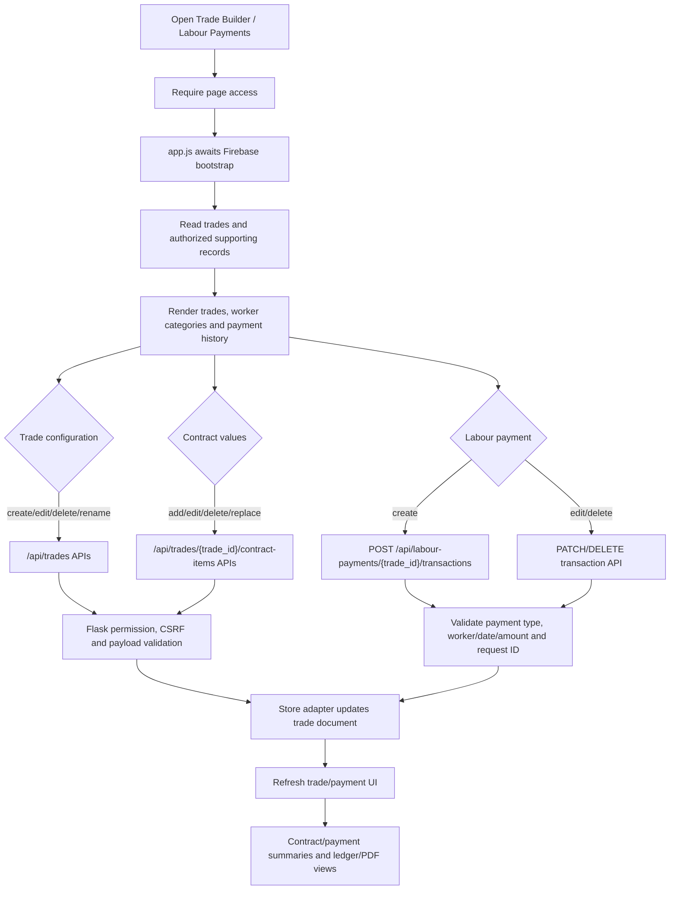

Trades, their contract items and labour payment transactions are managed
through the trade storage operations. Summary calculations and sorting have
client-side helper modules with corresponding tests.

### 6.6 Owner Scope and Building Cost Summary

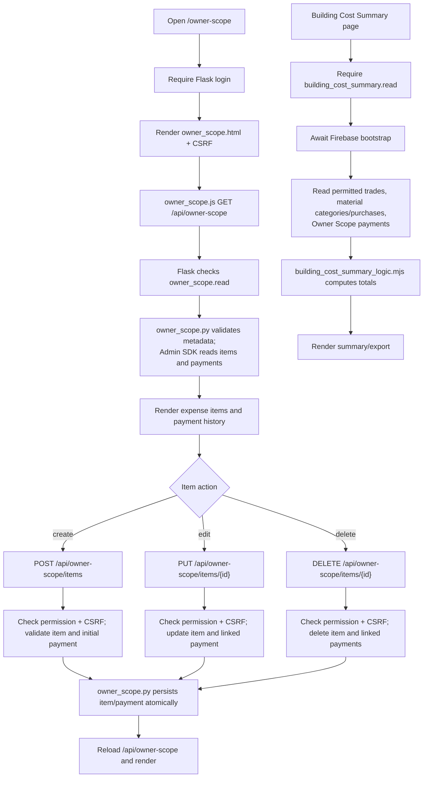

Owner Scope retains a validated reference to a designated legacy Owner Account
trade for migration/compatibility. It is not a general trade-to-scope foreign
key.

### 6.7 Ledger and reports

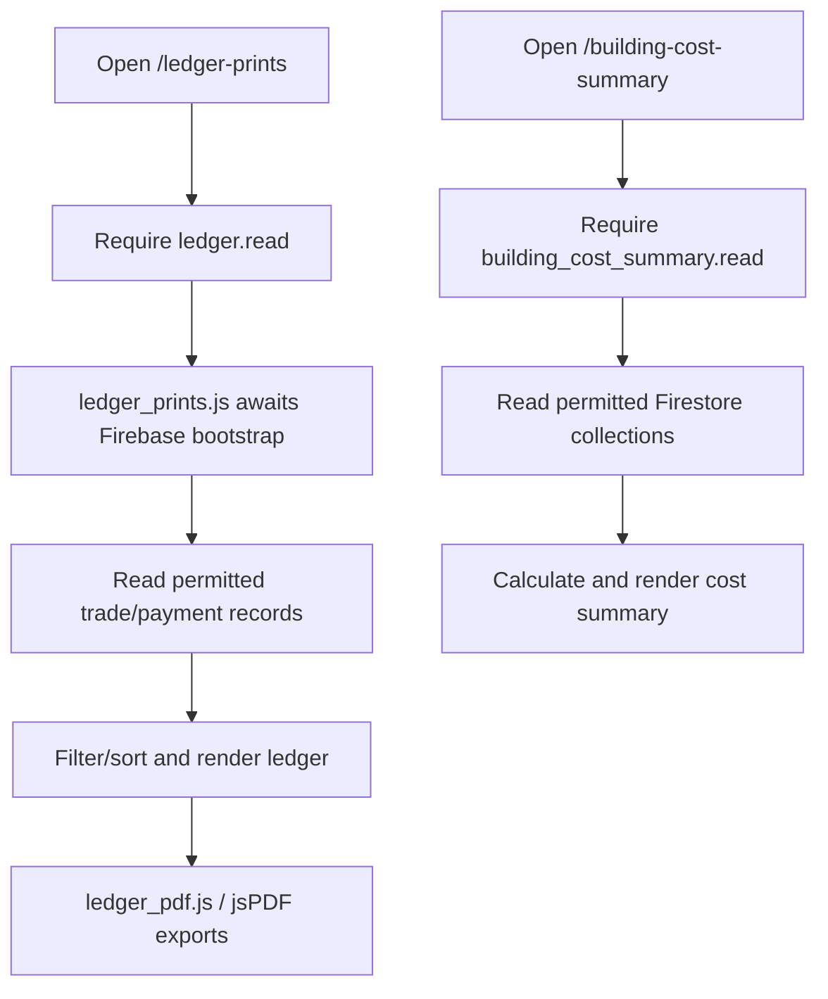

### 6.8 Authentication recovery, profile and account administration

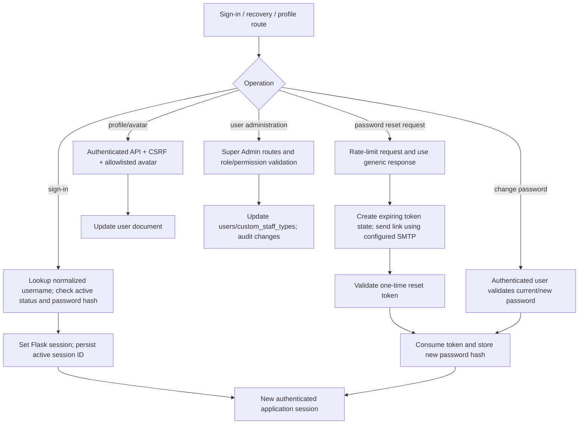

SMTP connectivity and Firebase service availability are environment-dependent;
this flow shows the intended code path, not a claim of successful delivery.

### 6.9 Snapshots and project restore/switch

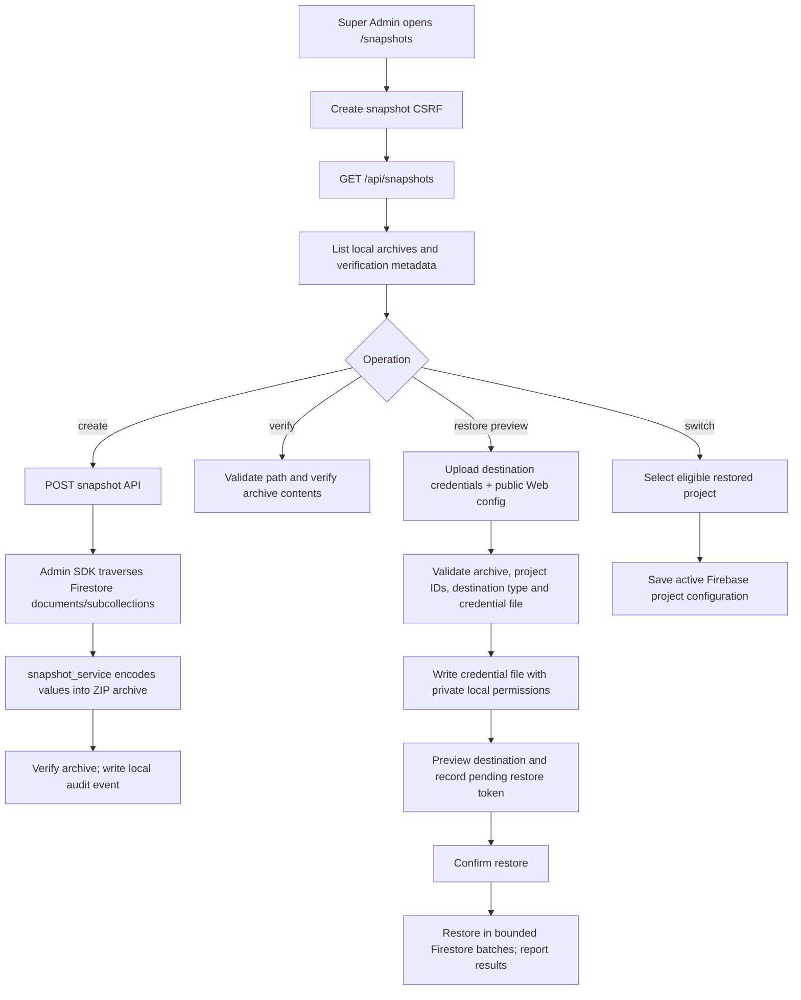

Snapshot archives, restore audit logs and staged credential files live on the
application host's filesystem. Their persistence depends on the host's storage
configuration.

### 6.10 Google Photos and camera authentication

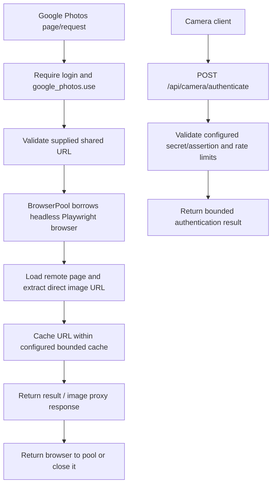

## 7. Representative object diagrams

The IDs and values below are synthetic labels used only to explain object
relationships. They are not records copied from the configured database.

### 7.1 Authenticated user and session

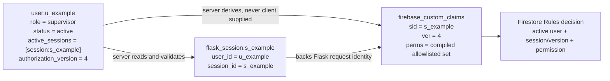

### 7.2 Materials and stock transaction records

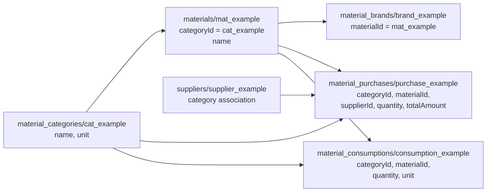

### 7.3 Construction records and payments

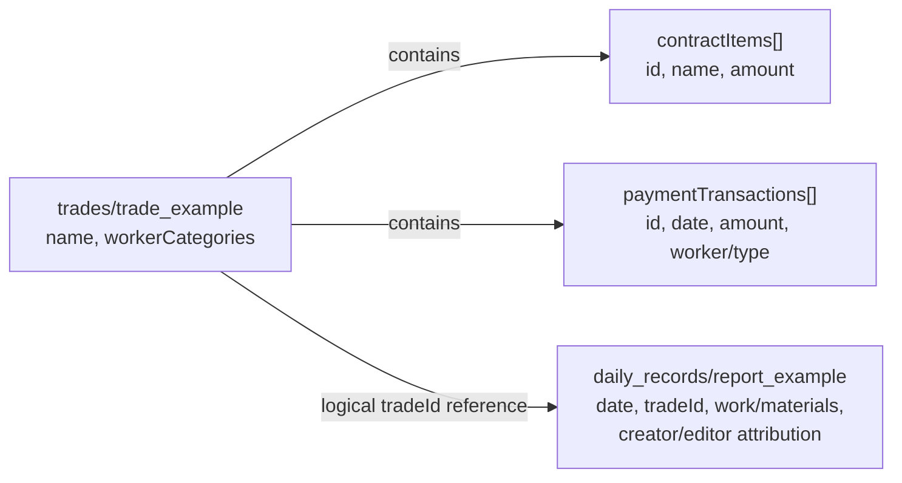

### 7.4 Drawings library

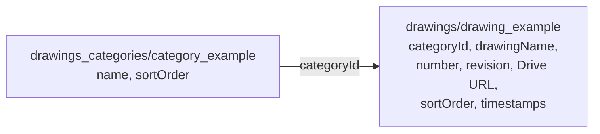

### 7.5 Owner Scope

```mermaid
flowchart LR
    Scope["owner_scopes/owner-scope<br/>name = Owner Scope<br/>legacySource = validated legacy trade"]
    Item["owner_scopes/owner-scope/items/item_example<br/>name, category, remarks"]
    Pay["owner_scopes/owner-scope/payments/payment_example<br/>expenseItemId, date, amount,<br/>paymentMode, remarks"]
    Legacy["trades/{designated legacy ID}<br/>legacy Owner Account source"]
    Scope -->|"contains subcollection"| Item
    Scope -->|"contains subcollection"| Pay
    Pay -->|"expenseItemId"| Item
    Scope -. "legacySource metadata checked against" .-> Legacy
```

### 7.6 Snapshot archive

```mermaid
flowchart LR
    Archive["local ZIP snapshot"]
    Metadata["metadata.json<br/>format version, project ID,<br/>created time, collection counts"]
    Documents["documents.jsonl<br/>collection path, document ID,<br/>encoded Firestore data"]
    Audit["local snapshot audit event"]
    Archive --> Metadata
    Archive --> Documents
    Audit -. "records snapshot operation" .-> Archive
```

## 8. Route/API inventory

This is grouped by route family to make the public surface navigable; variable
segments such as IDs are shown symbolically.

| Route family | Operations |
|---|---|
| Health/static | `GET/HEAD /health`, `/favicon.ico`, static asset delivery |
| Main pages | `/`, `/profile-settings`, `/trade-builder`, `/ledger-prints`, `/drawings`, `/materials`, `/building-cost-summary`, `/labour-payments`, `/owner-scope`, `/daily-reports`, `/google-photos`, `/user-guide`, `/developer-guide` |
| Firebase bridge | `GET /api/firebase-web-config`; `GET/POST /api/firebase-custom-token` |
| Authentication and recovery | `/login`, `/logout`, `/password-reset-request`, `/reset-password/{user_id}`, `/reset-password/{user_id}/validate`, `/forgot-password`, `/change-password`, `/super-admin-recovery`, `/test-email` |
| Profile and camera | `PATCH /api/profile`, `POST /api/profile/avatar`, `POST /api/camera/authenticate` |
| User administration | `/user-management`, `/user-management/create`, `/user-management/custom-type` and `/{staff_type_id}/edit|delete`, `/user-management/{user_id}`, `/{user_id}/edit`, `/{user_id}/toggle-status`, `/{user_id}/reset-password` |
| Drawings | Categories create/update/delete/order; drawings create/update/delete; category drawing order under `/api/drawings/...` |
| Materials | Category and supplier create/update/delete under `/api/material-master/...`; purchase/consumption create/update/delete under `/api/material-transactions/{kind}...` |
| Trades/contracts | Trade create/update/delete/rename under `/api/trades`; contract item create/replace/update/delete under `/api/trades/{trade_id}/contract-items...` |
| Labour payments | Create/update/delete under `/api/labour-payments/{trade_id}/transactions...` |
| Owner Scope | `GET /api/owner-scope`; item create `POST /api/owner-scope/items`; item `PUT/DELETE /api/owner-scope/items/{item_id}`. Initial and linked payment records are managed by item operations; there is no separate payment CRUD route in this API family |
| Daily Records | Dates, author avatars, trade options, create/update/delete under `/api/daily-records...`; share image under `/daily-reports/share-image` |
| Snapshots | `/snapshots`, `/api/snapshots` create/list, verify/delete/open-folder, restore preview/confirmation, switch-project/switch-back |
| Google Photos | `/google-photos`, `/extract-google-photos-url`, `/image` |

Authorization is not uniform solely by URL family. Feature APIs apply their
own permission and CSRF checks; use the corresponding route handler as the
source of truth for required permissions, methods, payloads and status codes.

## 9. Firestore Rules summary

`firestore.rules` validates the Firebase user's UID against the Flask-owned
`users/{uid}` record and checks:

1. A non-null Firebase auth token.
2. An active session ID claim still present in the user's `active_sessions`.
3. An active account and no forced password change.
4. Matching authorization-version claim.
5. The required permission claim for the target read.

Rules allow only selected `get/list` operations for the modules in use. They
explicitly deny direct browser writes and end with a catch-all deny. Admin SDK
requests bypass these rules and therefore rely on Flask route authorization and
domain validation.

## 10. Local configuration and test boundaries

- `python app.py` runs the Flask development server as documented in `README.txt`.
- `wsgi.py` is the Waitress entry point and validates secure production startup
  settings before serving.
- `FIREBASE_PROJECT_ID`, public `FIREBASE_WEB_CONFIG`, and Firebase Admin
  credentials configure the Firebase integration. Keep Admin credentials and
  `.env` contents out of browser assets and source-control artifacts.
- `FIRESTORE_MODE=memory` / explicit in-memory store injection is for isolated
  testing only; it is not persistent Firebase readiness.
- `firebase.json` configures the Firestore Rules emulator on port 8080. The
  repository's `package.json` exposes `npm run test:rules`.
- Python route/domain tests are in `tests/test_*.py`; JavaScript logic and Rules
  tests are in `tests/*.mjs`.
- `instance/` and `backups/` are local filesystem storage and are not durable
  cloud storage by themselves.

## 11. Change-impact guide

| Change area | Review alongside |
|---|---|
| Authentication/session | `app.py`, `permission_policy.py`, `firestore.rules`, `static/firebase_auth.js`, auth tests |
| Permission identifiers/roles | `permission_policy.py`, Flask feature guards, custom token claims, `firestore.rules`, permission and rules tests |
| Firestore collection/schema | Both store adapters, feature validators/routes, browser read queries, Rules, migrations and relevant tests |
| Materials calculations | `app.py` transaction/domain checks, `static/materials.js`, `static/materials_logic.mjs`, materials API and logic tests |
| Trade/payments | Trade store methods, trade/payment API guards and validators, `static/app.js`, calculation/sort helpers and tests |
| Owner Scope | `owner_scope.py`, routes in `app.py`, `static/owner_scope*.{js,mjs}`, Firestore Rules and migration tests |
| Snapshot format/restore | `snapshot_service.py`, `snapshot_routes.py`, `static/snapshots.js`, snapshot tests and deployment/storage expectations |
| A browser page | Its template, loaded browser modules/styles, APIs, authorization/CSRF checks and matching tests |
